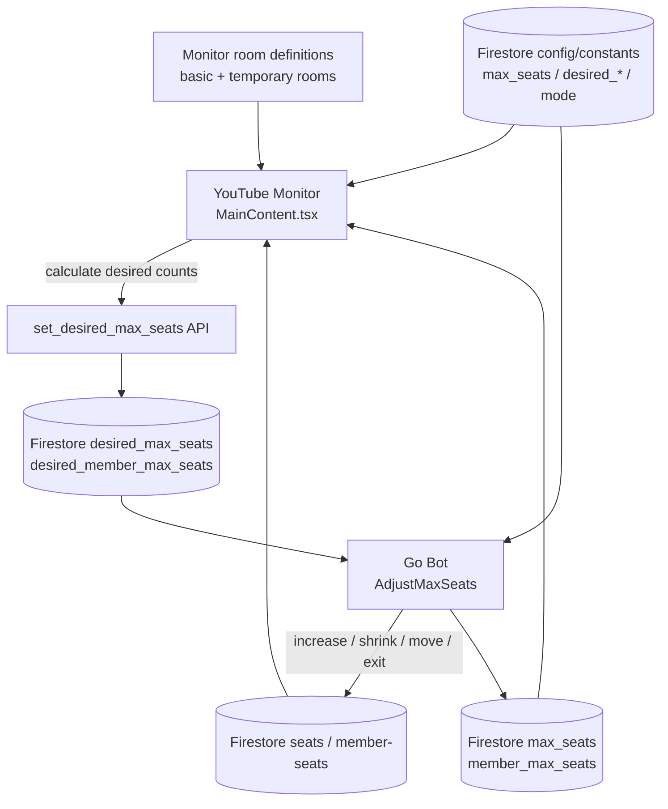

# Developer Architecture Notes

This document records architecture details that are easy to miss when changing one component in isolation. Runtime code and tests remain authoritative; update this document when the responsibility boundary changes.

## Room state and max-seat control

The livestream monitor is currently both a renderer and one participant in the max-seat control loop.



### Values with different roles

| Value | Role | Primary source/consumer |
| --- | --- | --- |
| `max_seats` / `member_max_seats` | Current seat-count limit used by the system. | Firestore `config/constants`; backend reconciliation and monitor layout construction |
| `desired_max_seats` / `desired_member_max_seats` | Requested target. The monitor writes these through the API; the Bot reconciles current limits toward them. | `set_desired_max_seats` Lambda, `WorkspaceApp.AdjustMaxSeats` |
| Basic room seat count | Capacity explicitly represented by the normal room-layout definitions. In fixed mode this becomes the requested capacity. | `youtube-monitor/src/rooms/rooms-config.ts` |
| Temporary rooms | Extra layouts used to cover variable capacity when more seats are required. | `youtube-monitor/src/rooms/rooms-config.ts`, layout builders |

### Fixed-seat mode

When `fixed_max_seats_enabled` is true, the monitor uses the total seats in the **basic room definitions** as the desired general capacity, and the corresponding fixed-member logic for member seats. Temporary rooms are not the mechanism for expanding fixed capacity.

On the backend, shrinking a fixed capacity is operationally significant: `max_seats_adjustment.go` can make users whose seat IDs are above the new limit exit. Therefore changing the number of seats in a basic layout can change system behavior even if the diff appears to be visual-only.

### Variable-seat mode

When fixed mode is disabled, the monitor calculates desired capacity from current occupancy, `min_vacancy_rate`, the basic-room capacity, and temporary-room definitions. Temporary rooms allow the UI to cover capacity beyond the basic rooms while the desired/current values converge.

The backend rejects a shrink that would violate the configured vacancy constraint. When shrinking is valid, users occupying seats above the new limit may be moved before `max_seats` is updated.

### Change checklist for monitor layouts

Before treating a layout change as visual-only, answer all of these:

1. Does the change alter the number of seats in any basic room?
2. Does it alter temporary-room capacity or ordering?
3. What desired counts are produced in fixed and variable modes?
4. Can any occupied seat ID become greater than the requested/current maximum?
5. Are general and member room calculations both covered?

See [`../../youtube-monitor/README.md`](../../youtube-monitor/README.md) for build/test setup.

## Firestore access boundaries

### モニター認証

OBSの`youtube-monitor`はFirebaseのブラウザClient SDKを使う。現在のソースでは`seats`・`member-seats`・`menu`・`work-name-trend`・`config/constants`の読み取りに、Firebase Authでログインし、そのUIDが有効な許可リスト（`_monitor-readers/{uid}`）に登録されていることを必要とする。custom claimは参照しない。匿名と、許可リストにない通常のMyPageユーザーは拒否する。このソースだけでは、DEVやPRODのRulesとモニター資産が一緒に配備済みとは証明できない。サーバー側のGo/Admin SDKは、これらのRulesではなくIAMとアプリケーション認可を使う。Security RulesはWAFや費用上限の代替にはならない。

実装済みの運用手順ではOBSブラウザ上で一度対話的にログインし、Firebaseのローカル永続化を使う。OBS/CEF再起動時の動作とトークン復元は未検証であり、シーン切替、認証失効時の通知・復旧も含めて実環境で受入試験を行う必要がある。Firestore購読を変更する際は、既存の`set_desired_max_seats`制御ループを維持する。[モニター課題 #1459](https://github.com/kani3camp/youtube-study-space/issues/1459)、[Firebase Rulesの案内](../../firebase/README.md)、[MyPage Phase 0B条件 #1133](https://github.com/kani3camp/youtube-study-space/issues/1133)に従う。

Server-side Go repository tests and browser Client SDK security rules answer different questions:

- normal `go test ./...` validates code without the integration build tag;
- `bash .github/scripts/run-firestore-integration-tests.sh` validates repository/application behavior against Firestore Emulator semantics;
- Firestore Security Rules govern what browser/client SDK callers can read/write and require client-oriented rule validation when that boundary changes.

See [`../../firebase/README.md`](../../firebase/README.md).

## Formal specifications

Seat behavior has formal-spec documentation under [`../../formal-spec/`](../../formal-spec/). The FSL documentation distinguishes contracts that are linked to Go verification from specifications that are currently descriptive/unlinked. Do not weaken a specification to make CI pass, and do not assume an unlinked specification is already enforced by the implementation.

## Privacy and retention

Changes to storage, forwarding, archival, or deletion must also be checked against [`../privacy/`](../privacy/). In particular, historical descriptions of raw live-chat archival must not be reintroduced as current architecture after that path has been retired.

## Current architecture vs desired direction

**Current fact:** the monitor participates in max-seat control as described above.

**Design direction:** prefer moving control decisions out of the presentation client so the monitor can eventually become a read/render-only component. This is a target boundary, not a statement that migration is complete. Until code changes remove the request path, reviews and tests must assume the current control loop exists.

## CI validation boundaries

[CI](../../.github/workflows/ci.yml) is the pull-request orchestrator: it detects changed paths, calls same-tree reusable validation workflows, and publishes the required checks. The validation commands remain in independent jobs so their parallelism and per-job timeouts are preserved.

| Reusable workflow | Responsibility |
| --- | --- |
| [ci-system.yml](../../.github/workflows/ci-system.yml) | Go lint/tests, generated files, Firestore Emulator |
| [ci-frontend.yml](../../.github/workflows/ci-frontend.yml) | YouTube Monitor and Docs Site checks/builds |
| [ci-tools.yml](../../.github/workflows/ci-tools.yml) | Room Image Prompt, Menu Image Generator, Video Maker Simulator, Figma plugin, Formal Spec |
| [ci-infra.yml](../../.github/workflows/ci-infra.yml) | AWS CDK tests and synth; no deployment |
| [ci-repository.yml](../../.github/workflows/ci-repository.yml) | Base-image report tests, Node runtime/`@types/node` policy, documentation links, CI workflow contracts/actionlint |
| [ci-gcp-terraform.yml](../../.github/workflows/ci-gcp-terraform.yml) | Core GCP Terraform、MyPage platform、MyPage OAuth TTL、Production readiness / runtime ownership のcredentialless IaC検証。`ci.yml`は自分のcommit、`terraform.yml`はPlan/Applyする固定commitを渡す |

The modules accept only typed selection flags, use read-only repository permissions, and receive no operational secrets or Environments. [Path detection](../../.github/scripts/detect-ci-paths.sh) selects the same validation domains as before; changes to workflows, shared CI actions, or CI selection/result contracts select the full suite. Unchanged domains can skip. Repository checks always run, including during authenticated Terraform dispatches.

Repository Ruleset が要求するCI statusは `CI Gate` だけです。`GCP Terraform Validate` は `CI Gate` 配下の安定した内部check名として維持し、Rulesetを個別job構造へ結合しません。Other validation check names acquire their caller prefix (for example, `System / Go Lint`); they are covered by `CI Gate`. The [gate result policy](../../.github/scripts/check-ci-results.py) rejects failed/cancelled reusable calls, missing or malformed detection outputs, unsuccessful detection/repository checks, and skipped selected modules. MyPage platform / OAuth TTL / Production readiness / runtime ownership を含むGCP IaC検証は `CI GCP Terraform` に集約されています。

MyPageのアプリケーション配備は、ユースケースごとの最上位workflow（`Deploy MyPage API` / `Deploy MyPage Frontend` / `Deploy Maintenance Operator`）が扱い、`ci.yml`からは呼ばない。各Deploy workflowは配備するdomainのcredentialless検査を同じrunで、資格情報の取得前に通す。Terraformの手動Plan / Applyは`Terraform`（`terraform.yml`）が扱う。`ci.yml`は資格情報を持たない検査だけを行い、手動実行（入力なし）も全domainの再検査にとどまる。移行状況は[CI / Terraform / Deploy / Operation workflow](ci-cd-workflows.md)を正とする。最上位workflowを新設・改名するときは、実AWS/GCPの信頼設定（`workflow_ref`）を段階変更する必要がある。CodeQLは独立したセキュリティ解析ワークフローのままとする。

`terraform.yml`は最初に対象commitを1つ確定し（[source resolver](../../.github/scripts/terraform_source_pin.py)。DEV Coreだけ別ブランチ／SHAを選べる）、`ci-gcp-terraform.yml`でそのcommitを検査してから、同じSHAをPlan/Applyへ渡す。検査ツールと[コンテナの実行スクリプト](../../.github/ci-validation/validate.sh)は、対象ソースを取得する前に実行元のcheckoutからビルドする。対象コードは非rootのDockerコンテナ内だけで実行し、ソースを読み取り専用でマウントして使い捨てのメモリ上の作業領域へコピーする。runnerの環境変数、Actionsのキャッシュ・runtimeトークン、コマンドファイル、Dockerソケットは渡さない。コンテナの出力によるrunnerコマンドの実行を停止し、コンテナの失敗はjobの失敗へ伝播する。`workflow_dispatch`では、`GITHUB_TOKEN`をread-onlyにするだけではActionsのキャッシュ用トークンへのアクセスを防げない。

ユースケース単位のworkflowへの移行計画と、各workflowの資格情報・Environment・排他の棚卸しは[CI / Terraform / Deploy / Operation workflow](ci-cd-workflows.md)を参照する。

Local source verification (with the pinned parser from `.github/codeql/requirements.txt` installed):

```sh
python3 -m unittest discover -s .github/scripts -p 'test_ci_*.py' -v
bash .github/scripts/test-detect-ci-paths.sh
```

CIは固定バージョンのactionlintで、統括ワークフロー、全再利用検証モジュール、運用用の再利用ワークフローも検査する。選択の仕様テストは全検出フラグの組み合わせを調べ、結果の仕様テストは失敗・キャンセル・選択済みモジュールのスキップ・不完全な検出を検証する。独立したCodeQLソース仕様ワークフローは、自身のソースとactionlint対象を引き続き検証する。
