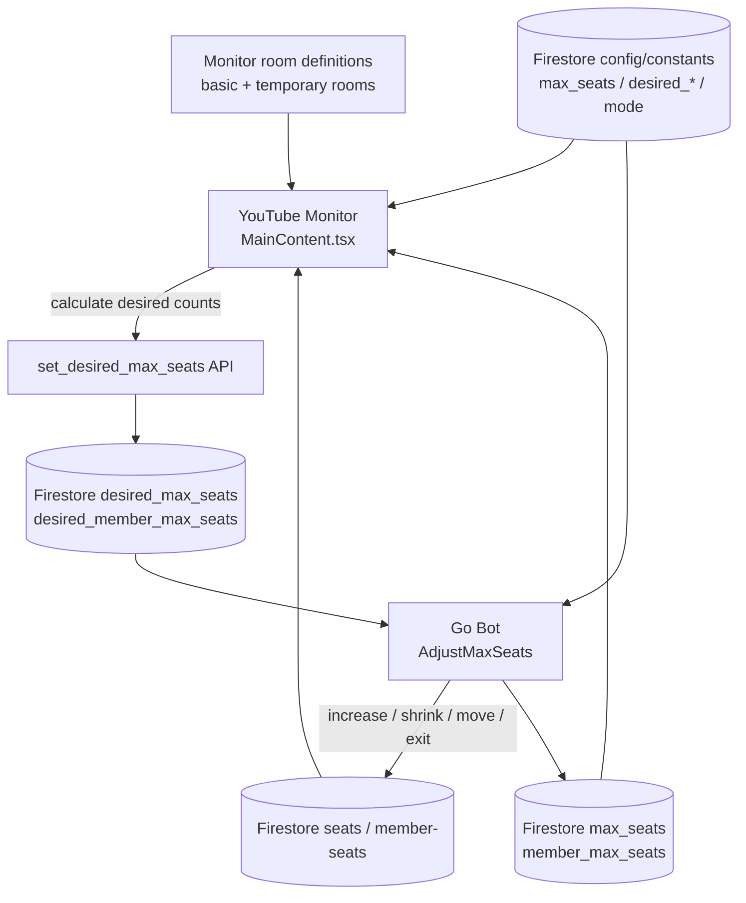

# Developer Architecture Notes

This document records architecture details that are easy to miss when changing one component in isolation. Runtime code and tests remain authoritative; update this document when the responsibility boundary changes.

## Room state and max-seat control

The livestream monitor is currently both a renderer and one participant in the max-seat control loop.



### Values with different roles

| Value | Role | Primary source/consumer |
| --- | --- | --- |
| `max_seats` / `member_max_seats` | Current seat-count limit used by the system. | Firestore `config/constants`; backend reconciliation and monitor layout construction |
| `desired_max_seats` / `desired_member_max_seats` | Requested target. The monitor writes these through the API; the Bot reconciles current limits toward them. | `set_desired_max_seats` Lambda, `WorkspaceApp.AdjustMaxSeats` |
| Basic room seat count | Capacity explicitly represented by the normal room-layout definitions. In fixed mode this becomes the requested capacity. | `youtube-monitor/src/rooms/rooms-config.ts` |
| Temporary rooms | Extra layouts used to cover variable capacity when more seats are required. | `youtube-monitor/src/rooms/rooms-config.ts`, layout builders |

### Fixed-seat mode

When `fixed_max_seats_enabled` is true, the monitor uses the total seats in the **basic room definitions** as the desired general capacity, and the corresponding fixed-member logic for member seats. Temporary rooms are not the mechanism for expanding fixed capacity.

On the backend, shrinking a fixed capacity is operationally significant: `max_seats_adjustment.go` can make users whose seat IDs are above the new limit exit. Therefore changing the number of seats in a basic layout can change system behavior even if the diff appears to be visual-only.

### Variable-seat mode

When fixed mode is disabled, the monitor calculates desired capacity from current occupancy, `min_vacancy_rate`, the basic-room capacity, and temporary-room definitions. Temporary rooms allow the UI to cover capacity beyond the basic rooms while the desired/current values converge.

The backend rejects a shrink that would violate the configured vacancy constraint. When shrinking is valid, users occupying seats above the new limit may be moved before `max_seats` is updated.

### Change checklist for monitor layouts

Before treating a layout change as visual-only, answer all of these:

1. Does the change alter the number of seats in any basic room?
2. Does it alter temporary-room capacity or ordering?
3. What desired counts are produced in fixed and variable modes?
4. Can any occupied seat ID become greater than the requested/current maximum?
5. Are general and member room calculations both covered?

See [`../../youtube-monitor/README.md`](../../youtube-monitor/README.md) for build/test setup.

## Firestore access boundaries

Server-side Go repository tests and browser Client SDK security rules answer different questions:

- normal `go test ./...` validates code without the integration build tag;
- `bash .github/scripts/run-firestore-integration-tests.sh` validates repository/application behavior against Firestore Emulator semantics;
- Firestore Security Rules govern what browser/client SDK callers can read/write and require client-oriented rule validation when that boundary changes.

See [`../../firebase/README.md`](../../firebase/README.md).

## Formal specifications

Seat behavior has formal-spec documentation under [`../../formal-spec/`](../../formal-spec/). The FSL documentation distinguishes contracts that are linked to Go verification from specifications that are currently descriptive/unlinked. Do not weaken a specification to make CI pass, and do not assume an unlinked specification is already enforced by the implementation.

## Privacy and retention

Changes to storage, forwarding, archival, or deletion must also be checked against [`../privacy/`](../privacy/). In particular, historical descriptions of raw live-chat archival must not be reintroduced as current architecture after that path has been retired.

## Current architecture vs desired direction

**Current fact:** the monitor participates in max-seat control as described above.

**Design direction:** prefer moving control decisions out of the presentation client so the monitor can eventually become a read/render-only component. This is a target boundary, not a statement that migration is complete. Until code changes remove the request path, reviews and tests must assume the current control loop exists.

## CI validation boundaries

[CI](../../.github/workflows/ci.yml) is the pull-request orchestrator: it detects changed paths, calls same-tree reusable validation workflows, and publishes the required checks. The validation commands remain in independent jobs so their parallelism and per-job timeouts are preserved.

| Reusable workflow | Responsibility |
| --- | --- |
| [ci-system.yml](../../.github/workflows/ci-system.yml) | Go lint/tests, generated files, Firestore Emulator |
| [ci-frontend.yml](../../.github/workflows/ci-frontend.yml) | YouTube Monitor and Docs Site checks/builds |
| [ci-tools.yml](../../.github/workflows/ci-tools.yml) | Room Image Prompt, Menu Image Generator, Video Maker Simulator, Figma plugin, Formal Spec |
| [ci-infra.yml](../../.github/workflows/ci-infra.yml) | AWS CDK tests and synth; no deployment |
| [ci-repository.yml](../../.github/workflows/ci-repository.yml) | Base-image report tests, Node LTS expiry, documentation links, CI workflow contracts/actionlint |
| [ci-gcp-terraform.yml](../../.github/workflows/ci-gcp-terraform.yml) | GCP Terraform fmt/validate, contract and native fixture tests, provider locks; also the pre-Plan validation of `terraform.yml` |

The modules accept typed selection flags (plus the exact source SHA for the repository and Terraform checks), use read-only repository permissions, and receive no operational secrets or Environments. [Path detection](../../.github/scripts/detect-ci-paths.sh) selects the same validation domains as before; changes to workflows, shared CI actions, or CI selection/result contracts select the full suite. Unchanged domains can skip. Repository checks always run after change detection. Manual CI runs take no input and re-validate every domain; `ci.yml` never authenticates.

The Repository Ruleset requires only `CI Gate`. Other validation check names acquire their caller prefix (for example, `System / Go Lint` and `GCP Terraform / GCP Terraform Validate`); they are covered by `CI Gate`. The [gate result policy](../../.github/scripts/check-ci-results.py) rejects failed/cancelled reusable calls, missing or malformed detection outputs, unsuccessful detection/repository checks, and skipped selected modules.

Terraform Plan / Apply is the separate [Terraform](../../.github/workflows/terraform.yml) workflow (owner `workflow_dispatch` only). Its [source resolver](../../.github/scripts/terraform_source_pin.py) uses the existing owner/ref/caller/source checks to pin one commit before validation. `ci-gcp-terraform.yml` checks out this exact commit, including its tests, with read-only permissions, no Environment secrets or OIDC, and no persisted checkout credentials. The authenticated reusable receives that SHA as `expected_sha` with an empty `source_branch`, so it cannot resolve a newer branch HEAD after validation. It rechecks DEV commit reachability, then uses this same SHA for both Plan and Apply. The resolver, workflow definitions and credentialed executor remain on the controller commit; PROD uses the controller's exact `main` SHA. PRs and CI runs validate `github.sha`.

検査ツールと[コンテナの実行スクリプト](../../.github/ci-validation/validate.sh)は、対象ソースを取得する前に実行元のcheckoutからビルドします。対象コードは非rootのDockerコンテナ内だけで実行し、ソースを読み取り専用でマウントして使い捨てのメモリ上の作業領域へコピーします。runnerの環境変数、Actionsのキャッシュ・runtimeトークン、コマンドファイル、Dockerソケットは渡しません。Repository共通検査は通信も禁止し、Terraform検査は公開providerの取得と資格情報なしのnative fixture用の通信を維持します。コンテナの出力によるrunnerコマンドの実行を停止し、コンテナの失敗はjobの失敗へ伝播します。`workflow_dispatch`では、`GITHUB_TOKEN`をread-onlyにするだけではActionsのキャッシュ用トークンへのアクセスを防げません。

The Terraform caller path (`terraform.yml`) is part of the cloud trust contract. DEV trust already admits it; PROD trust must be switched from `ci.yml` to `terraform.yml` before this reaches `main` (see [GCP Terraform](../../infra/gcp/README.md)). Existing CodeQL, GCP Production Readiness and GCP Runtime Ownership Contracts workflows retain their separate responsibilities.

Local source verification (with the pinned parser from `.github/codeql/requirements.txt` installed):

```sh
python3 -m unittest discover -s .github/scripts -p 'test_ci_*.py' -v
bash .github/scripts/test-detect-ci-paths.sh
```

CI additionally runs pinned actionlint against the orchestrator, all five modules, and the two operational reusable workflows. Selection contracts exhaust all 8,192 combinations of detection flags; result contracts exercise failures, cancellations, skipped selected modules, and incomplete detection. The independent CodeQL source-contract workflow continues to validate its own source and actionlint scope.
