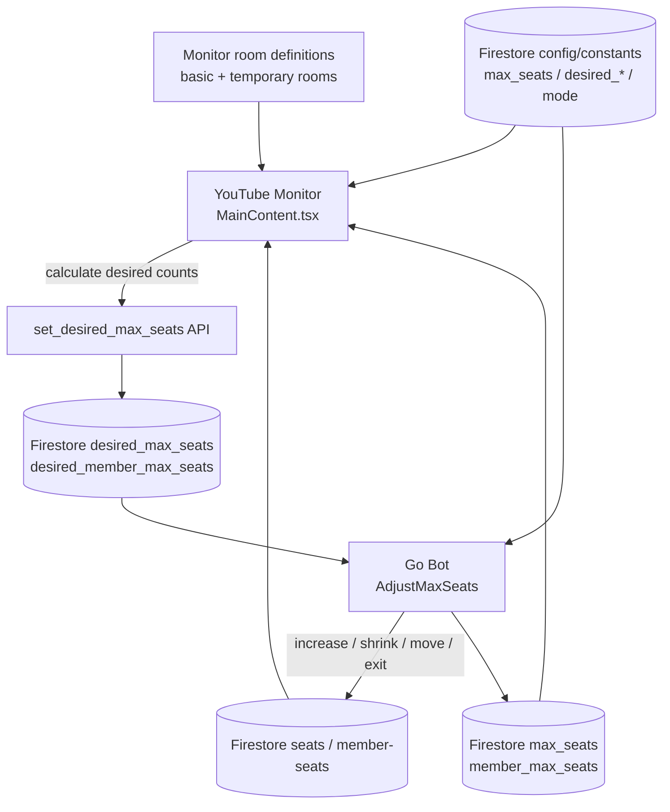

# Developer Architecture Notes

This document records architecture details that are easy to miss when changing one component in isolation. Runtime code and tests remain authoritative; update this document when the responsibility boundary changes.

## Room state and max-seat control

The livestream monitor is currently both a renderer and one participant in the max-seat control loop.



### Values with different roles

| Value | Role | Primary source/consumer |
| --- | --- | --- |
| `max_seats` / `member_max_seats` | Current seat-count limit used by the system. | Firestore `config/constants`; backend reconciliation and monitor layout construction |
| `desired_max_seats` / `desired_member_max_seats` | Requested target. The monitor writes these through the API; the Bot reconciles current limits toward them. | `set_desired_max_seats` Lambda, `WorkspaceApp.AdjustMaxSeats` |
| Basic room seat count | Capacity explicitly represented by the normal room-layout definitions. In fixed mode this becomes the requested capacity. | `youtube-monitor/src/rooms/rooms-config.ts` |
| Temporary rooms | Extra layouts used to cover variable capacity when more seats are required. | `youtube-monitor/src/rooms/rooms-config.ts`, layout builders |

### Fixed-seat mode

When `fixed_max_seats_enabled` is true, the monitor uses the total seats in the **basic room definitions** as the desired general capacity, and the corresponding fixed-member logic for member seats. Temporary rooms are not the mechanism for expanding fixed capacity.

On the backend, shrinking a fixed capacity is operationally significant: `max_seats_adjustment.go` can make users whose seat IDs are above the new limit exit. Therefore changing the number of seats in a basic layout can change system behavior even if the diff appears to be visual-only.

### Variable-seat mode

When fixed mode is disabled, the monitor calculates desired capacity from current occupancy, `min_vacancy_rate`, the basic-room capacity, and temporary-room definitions. Temporary rooms allow the UI to cover capacity beyond the basic rooms while the desired/current values converge.

The backend rejects a shrink that would violate the configured vacancy constraint. When shrinking is valid, users occupying seats above the new limit may be moved before `max_seats` is updated.

### Change checklist for monitor layouts

Before treating a layout change as visual-only, answer all of these:

1. Does the change alter the number of seats in any basic room?
2. Does it alter temporary-room capacity or ordering?
3. What desired counts are produced in fixed and variable modes?
4. Can any occupied seat ID become greater than the requested/current maximum?
5. Are general and member room calculations both covered?

See [`../../youtube-monitor/README.md`](../../youtube-monitor/README.md) for build/test setup.

## Firestore access boundaries

### モニター認証

OBS 上の `youtube-monitor` は Firebase のブラウザ Client SDK を使用します。現在のソースコードでは `seats`・`member-seats`・`menu`・`work-name-trend`・`config/constants` を読み取るために Firebase Auth でログインし、その UID が有効な許可リスト（`_monitor-readers/{uid}`）に登録されている必要があります（custom claim は参照せず、匿名ユーザーや許可リスト外の通常 MyPage ユーザーは拒否します）。

- ソースコードが存在することと DEV/PROD の Rules やモニター資産が配備済みであることは別であり、Security Rules は WAF や費用上限の代替になりません（サーバー側の Go / Admin SDK は IAM とアプリ認可を使用）。
- OBS ブラウザ上で一度対話的にログインし Firebase のローカル永続化を使う前提です。DEV・本番で適用中の Rules と OBS 実機での再起動・長時間稼働後の復帰・認証失効時の通知と復旧等は 2026-11-15（`v4.33.0` / [#1459](https://github.com/kani3camp/youtube-study-space/issues/1459)）で運営者確認済みですが、クライアント構成や Firestore 購読を変更する場合は既存の `set_desired_max_seats` 制御ループを維持しつつ同範囲の受入試験を再確認してください。
- 関連資料は [モニター課題 #1459](https://github.com/kani3camp/youtube-study-space/issues/1459) / [Firebase Rules 案内](../../firebase/README.md) / [MyPage Phase 0B 条件 #1133](https://github.com/kani3camp/youtube-study-space/issues/1133) を参照してください。

Server-side Go repository tests and browser Client SDK security rules answer different questions:

- normal `go test ./...` validates code without the integration build tag;
- `bash .github/scripts/run-firestore-integration-tests.sh` validates repository/application behavior against Firestore Emulator semantics;
- Firestore Security Rules govern what browser/client SDK callers can read/write and require client-oriented rule validation when that boundary changes.

See [`../../firebase/README.md`](../../firebase/README.md).

## Formal specifications

Seat behavior has formal-spec documentation under [`../../formal-spec/`](../../formal-spec/). The FSL documentation distinguishes contracts that are linked to Go verification from specifications that are currently descriptive/unlinked. Do not weaken a specification to make CI pass, and do not assume an unlinked specification is already enforced by the implementation.

## Privacy and retention

Changes to storage, forwarding, archival, or deletion must also be checked against [`../privacy/`](../privacy/). In particular, historical descriptions of raw live-chat archival must not be reintroduced as current architecture after that path has been retired.

## Current architecture vs desired direction

**Current fact:** the monitor participates in max-seat control as described above.

**Design direction:** prefer moving control decisions out of the presentation client so the monitor can eventually become a read/render-only component. This is a target boundary, not a statement that migration is complete. Until code changes remove the request path, reviews and tests must assume the current control loop exists.

## CIの検証境界

[CI](../../.github/workflows/ci.yml) は PR の変更パスを検出し、同じツリーの再利用可能な検証ワークフローを呼び出して必須チェックを報告します（常時実行の Repository 検証は 1 ジョブにまとめ、4 つの検証を独立したコンテナで順次実行します）。

| 再利用可能 Workflow | 責務 |
| --- | --- |
| [ci-system.yml](../../.github/workflows/ci-system.yml) | Go lint・テスト、生成ファイル、Firestore Emulator |
| [ci-frontend.yml](../../.github/workflows/ci-frontend.yml) | YouTube Monitor・MyPage・Docs Site の検査とビルド |
| [ci-tools.yml](../../.github/workflows/ci-tools.yml) | Room Image Prompt・Menu Image Generator・Video Maker Simulator・Figma plugin・Formal Spec |
| [ci-infra.yml](../../.github/workflows/ci-infra.yml) | AWS CDK のテストと synth（デプロイなし） |
| [ci-repository.yml](../../.github/workflows/ci-repository.yml) | ベースイメージ報告テスト・Node 型定義ポリシー・文書リンク・CI 契約・actionlint |
| [ci-gcp-terraform.yml](../../.github/workflows/ci-gcp-terraform.yml) | Core GCP Terraform / MyPage platform / MyPage OAuth TTL の認証なし IaC 検証（`ci.yml` は自分の commit、`terraform.yml` は Plan/Apply 対象の固定 commit を渡す） |

### 変更検知と隔離コンテナでの実行

- [変更検知](../../.github/scripts/detect-ci-paths.sh) で変更したドメインを選択します（ワークフロー・共有 CI action・選択結果の契約・未分類の CI スクリプト変更時は全グループを選択。既知の文書チェッカー 2 本は常時実行の Repository 検証で網羅するため追加グループを選択しません）。変更のないドメインはスキップし、Repository 検証は毎回実行します（手動 `ci.yml` 実行も認証なしで全ドメインを再検査します）。
- Ruleset の必須チェックは `CI Gate` であり、[Gate の判定](../../.github/scripts/check-ci-results.py) が呼び出し先の失敗・キャンセル・変更検知欠損・Repository 検証未成功・選択モジュールのスキップを拒否します。
- 検査ツールと [コンテナ実行スクリプト](../../.github/ci-validation/validate.sh) は対象コード取得前に実行元の checkout からビルドします。Repository 検証は 1 ジョブで隔離イメージを 1 回ビルドし、`base-image`・`node-policy`・`docs`・`contracts` の 4 件を独立した非 root コンテナで読み取り専用マウントして実行します（runner 環境変数・キャッシュトークン・Docker ソケットは渡さず、Repository 共通検査は通信も禁止）。4 件すべての結果をログと Step Summary に記録し、1 件でも失敗すれば失敗とします（コンテナ出力は結果表へ取り込みません）。
- Terraform 検査では固定の検査（`fmt`・`validate`・provider lock・`terraform-static`）を対象コミットのテスト（`terraform-tests`）より前に別コンテナで実行し、テストコードによる HCL 書き換えが固定検査へ影響しないようにしています（`terraform-static` は `registry.terraform.io/hashicorp/*` のみ許可し、読み取り専用の `/source` に対して最後に `init`/`validate` を実行）。固定検査の完了後、対象コミットのテストは `contracts` と `native` の 2 つのシャードに分け、それぞれ別のコンテナで並列に実行します。どの検査が失敗しても他の検査は最後まで実行し、ジョブは失敗になります。シャードの割り当ては `validate.sh` とワークフローの両方に定義しており、[サンドボックスの契約テスト](../../.github/scripts/test_ci_validation_sandbox.py) で一致を確認しています。

### Terraform・アプリケーション配備との分担

- [Terraform](../../.github/workflows/terraform.yml) ワークフロー（オーナーによる `workflow_dispatch` および DEV PR Plan）が Plan / Apply を担当します。[ソース解決器](../../.github/scripts/terraform_source_pin.py) で対象 SHA を固定したうえで認証なし検証（`ci-gcp-terraform.yml`）を通し、認証付き実行器へ `expected_sha` を渡します（Plan ジョブと Apply ジョブがそれぞれ独立に Plan を生成し、HMAC 一致時のみ Apply 内の保存 Plan を適用するため、Core の適用前 Plan は計 2 回となり、適用後の no-op 検証 Plan も維持します）。
- MyPage のアプリケーション配備はユースケース別の最上位ワークフロー（`Deploy MyPage API` / `Deploy MyPage Frontend` / `Deploy Maintenance Operator`）が担当し、`ci.yml` からは呼び出しません（各 Deploy ワークフローは資格情報取得前に対象ドメインの認証なし検査を実行）。詳細は [CI / Terraform / Deploy / Operation workflow 設計](ci-cd-workflows.md) を参照してください。
- CodeQL・GCP Production Readiness・GCP Runtime Ownership Contracts は独立して維持します。CI 契約のローカル検証は以下のコマンドで行えます（`.github/codeql/requirements.txt` 導入済み環境）。

```sh
python3 -m unittest discover -s .github/scripts -p 'test_ci_*.py' -v
bash .github/scripts/test-detect-ci-paths.sh
```

CI では固定版 `actionlint` によるワークフロー検証、変更検知 8,192 通りの網羅テスト、結果判定の契約テストを実行しています。
