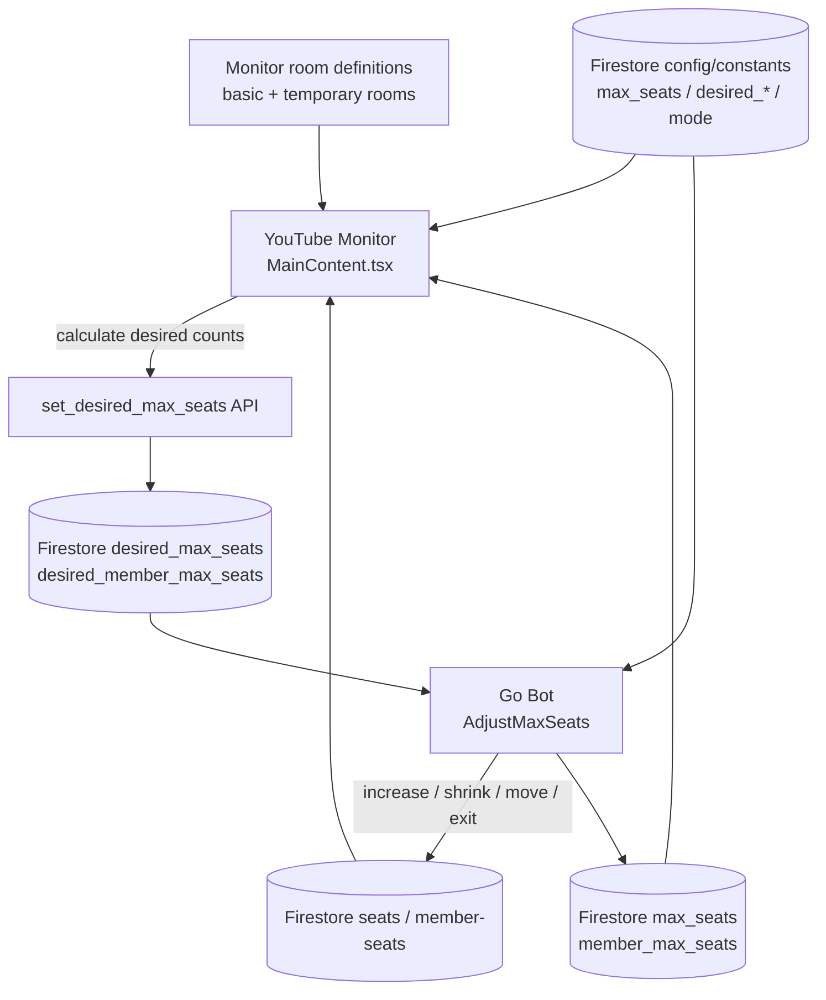

# Developer Architecture Notes

This document records architecture details that are easy to miss when changing one component in isolation. Runtime code and tests remain authoritative; update this document when the responsibility boundary changes.

## Room state and max-seat control

The livestream monitor is currently both a renderer and one participant in the max-seat control loop.



### Values with different roles

| Value | Role | Primary source/consumer |
| --- | --- | --- |
| `max_seats` / `member_max_seats` | Current seat-count limit used by the system. | Firestore `config/constants`; backend reconciliation and monitor layout construction |
| `desired_max_seats` / `desired_member_max_seats` | Requested target. The monitor writes these through the API; the Bot reconciles current limits toward them. | `set_desired_max_seats` Lambda, `WorkspaceApp.AdjustMaxSeats` |
| Basic room seat count | Capacity explicitly represented by the normal room-layout definitions. In fixed mode this becomes the requested capacity. | `youtube-monitor/src/rooms/rooms-config.ts` |
| Temporary rooms | Extra layouts used to cover variable capacity when more seats are required. | `youtube-monitor/src/rooms/rooms-config.ts`, layout builders |

### Fixed-seat mode

When `fixed_max_seats_enabled` is true, the monitor uses the total seats in the **basic room definitions** as the desired general capacity, and the corresponding fixed-member logic for member seats. Temporary rooms are not the mechanism for expanding fixed capacity.

On the backend, shrinking a fixed capacity is operationally significant: `max_seats_adjustment.go` can make users whose seat IDs are above the new limit exit. Therefore changing the number of seats in a basic layout can change system behavior even if the diff appears to be visual-only.

### Variable-seat mode

When fixed mode is disabled, the monitor calculates desired capacity from current occupancy, `min_vacancy_rate`, the basic-room capacity, and temporary-room definitions. Temporary rooms allow the UI to cover capacity beyond the basic rooms while the desired/current values converge.

The backend rejects a shrink that would violate the configured vacancy constraint. When shrinking is valid, users occupying seats above the new limit may be moved before `max_seats` is updated.

### Change checklist for monitor layouts

Before treating a layout change as visual-only, answer all of these:

1. Does the change alter the number of seats in any basic room?
2. Does it alter temporary-room capacity or ordering?
3. What desired counts are produced in fixed and variable modes?
4. Can any occupied seat ID become greater than the requested/current maximum?
5. Are general and member room calculations both covered?

See [`../../youtube-monitor/README.md`](../../youtube-monitor/README.md) for build/test setup.

## Firestore access boundaries

### モニター認証

OBSの`youtube-monitor`はFirebaseのブラウザClient SDKを使う。現在のソースでは`seats`・`member-seats`・`menu`・`work-name-trend`・`config/constants`の読み取りに、Firebase Authでログインし、そのUIDが有効な許可リスト（`_monitor-readers/{uid}`）に登録されていることを必要とする。custom claimは参照しない。匿名と、許可リストにない通常のMyPageユーザーは拒否する。このソースだけでは、DEVやPRODのRulesとモニター資産が一緒に配備済みとは証明できない。サーバー側のGo/Admin SDKは、これらのRulesではなくIAMとアプリケーション認可を使う。Security RulesはWAFや費用上限の代替にはならない。

実装済みの運用手順ではOBSブラウザ上で一度対話的にログインし、Firebaseのローカル永続化を使う。OBS/CEF再起動時の動作とトークン復元は未検証であり、シーン切替、認証失効時の通知・復旧も含めて実環境で受入試験を行う必要がある。Firestore購読を変更する際は、既存の`set_desired_max_seats`制御ループを維持する。[モニター課題 #1459](https://github.com/kani3camp/youtube-study-space/issues/1459)、[Firebase Rulesの案内](../../firebase/README.md)、[MyPage Phase 0B条件 #1133](https://github.com/kani3camp/youtube-study-space/issues/1133)に従う。

Server-side Go repository tests and browser Client SDK security rules answer different questions:

- normal `go test ./...` validates code without the integration build tag;
- `bash .github/scripts/run-firestore-integration-tests.sh` validates repository/application behavior against Firestore Emulator semantics;
- Firestore Security Rules govern what browser/client SDK callers can read/write and require client-oriented rule validation when that boundary changes.

See [`../../firebase/README.md`](../../firebase/README.md).

## Formal specifications

Seat behavior has formal-spec documentation under [`../../formal-spec/`](../../formal-spec/). The FSL documentation distinguishes contracts that are linked to Go verification from specifications that are currently descriptive/unlinked. Do not weaken a specification to make CI pass, and do not assume an unlinked specification is already enforced by the implementation.

## Privacy and retention

Changes to storage, forwarding, archival, or deletion must also be checked against [`../privacy/`](../privacy/). In particular, historical descriptions of raw live-chat archival must not be reintroduced as current architecture after that path has been retired.

## Current architecture vs desired direction

**Current fact:** the monitor participates in max-seat control as described above.

**Design direction:** prefer moving control decisions out of the presentation client so the monitor can eventually become a read/render-only component. This is a target boundary, not a statement that migration is complete. Until code changes remove the request path, reviews and tests must assume the current control loop exists.

## CIの検証境界

[CI](../../.github/workflows/ci.yml) はPRの変更パスを検出し、同じtreeの再利用可能な検証Workflowを呼び出して、必須checkを報告します。各ドメインの検証は独立したジョブで実行します。常時実行のRepository検証は1ジョブにまとめ、4つの検証を独立したコンテナで順次実行します。

| 再利用可能Workflow | 責務 |
| --- | --- |
| [ci-system.yml](../../.github/workflows/ci-system.yml) | Go lint・テスト、生成ファイル、Firestore Emulator |
| [ci-frontend.yml](../../.github/workflows/ci-frontend.yml) | YouTube MonitorとDocs Siteの検査・ビルド |
| [ci-tools.yml](../../.github/workflows/ci-tools.yml) | Room Image Prompt、Menu Image Generator、Video Maker Simulator、Figma plugin、Formal Spec |
| [ci-infra.yml](../../.github/workflows/ci-infra.yml) | AWS CDKのテストとsynth（デプロイなし） |
| [ci-repository.yml](../../.github/workflows/ci-repository.yml) | ベースイメージ報告のテスト、Node型定義のignore policy、文書リンク、CI契約・actionlint |
| [ci-gcp-terraform.yml](../../.github/workflows/ci-gcp-terraform.yml) | Core GCP Terraform、MyPage platform、MyPage OAuth TTL、Production readiness / runtime ownership のcredentialless IaC検証。`ci.yml`は自分のcommit、`terraform.yml`はPlan/Applyする固定commitを渡す |

各Workflowは型付きの選択フラグを受け取り、RepositoryとTerraformの検証には対象ソースのSHAも渡します。リポジトリ権限は読み取り専用とし、運用用のSecretやEnvironmentは受け取りません。[変更検知](../../.github/scripts/detect-ci-paths.sh) は変更したドメインを選択し、Workflow・共有CI action・選択結果の契約・未分類のCIスクリプトの変更は全グループを選択します。既知の文書チェッカー2本は常時実行のRepository検証で網羅するため、追加グループを選択しません。変更のないドメインはスキップできます。Repository検証は変更検知後に常に実行します。手動CIは入力なしで全ドメインを再検証し、`ci.yml`ではクラウド認証しません。

Repository検証は1ジョブで隔離用イメージを1回ビルドし、`base-image`、`node-policy`、`docs`、`contracts` をそれぞれ独立したコンテナで実行します。各コンテナは同じSHAのソースを読み取り専用で受け取り、書き込み領域を共有しません。4件すべての結果をログとホスト側のStep Summaryに記録し、1件でも失敗すればジョブとCI Gateは失敗します。コンテナ出力は結果表へ取り込みません。Terraform関連スクリプトは用途別の名前規則で分類します。

Repository Rulesetの必須checkは`CI Gate`です。ほかのcheck名には呼び出し元のprefixが付き（例：`System / Go Lint`、`GCP Terraform / GCP Terraform Validate`）、その結果を`CI Gate`が検証します。[Gateの判定](../../.github/scripts/check-ci-results.py)は、呼び出し先の失敗・キャンセル、変更検知outputsの欠損・不正、変更検知またはRepository検証の未成功、選択したモジュールのスキップを拒否します。

Terraform Plan / Applyは別の[Terraform](../../.github/workflows/terraform.yml) Workflowで実行します（ownerによる`workflow_dispatch`のみ）。[ソース解決器](../../.github/scripts/terraform_source_pin.py)は既存のowner・ref・caller・source検査で検証対象のコミットを固定します。`ci-gcp-terraform.yml`はテストを含めてこのSHAをcheckoutし、読み取り専用権限で検証します。EnvironmentのSecretやOIDCは使用せず、checkout認証情報も保持しません。認証付きの再利用可能WorkflowにはこのSHAを`expected_sha`として渡し、`source_branch`は空にするため、検証後に新しいブランチHEADへ解決し直すことはありません。DEVのコミット到達性を再検証し、PlanとApplyに同じSHAを使用します。解決器・Workflow定義・認証付き実行器はcontrollerのコミットに固定し、PRODではcontrollerの`main` SHAを使います。PRとCIは`github.sha`を検証します。

検査ツールと[コンテナの実行スクリプト](../../.github/ci-validation/validate.sh)は、対象ソースを取得する前に実行元のcheckoutからビルドします。対象コードは非rootのDockerコンテナ内だけで実行し、ソースを読み取り専用でマウントして使い捨てのメモリ上の作業領域へコピーします。runnerの環境変数、Actionsのキャッシュ・runtimeトークン、コマンドファイル、Dockerソケットは渡しません。Repository共通検査は通信も禁止し、Terraform検査は公開providerの取得と資格情報なしのnative fixture用の通信を維持します。コンテナの出力によるrunnerコマンドの実行を停止し、コンテナの失敗はjobの失敗へ伝播します。Terraform検査は、固定の検査（fmt・validate・provider lock、`terraform-static`）を、対象コミットのテスト（`terraform-tests`）より先に別のコンテナで実行します。各コンテナは読み取り専用のソースを新しくコピーするため、対象のテストがHCLを書き換えても固定の検査には影響しません。`terraform-static`はproviderの取得元を`registry.terraform.io/hashicorp/*`に限り（リポジトリ内の`terraform.d/plugins`などの暗黙のmirrorは使わない）、providerを起動するinit・validateは読み取り専用の`/source`に対して最後に実行します。`workflow_dispatch`では、`GITHUB_TOKEN`をread-onlyにするだけではActionsのキャッシュ用トークンへのアクセスを防げません。

MyPageのアプリケーション配備は、ユースケースごとの最上位workflow（`Deploy MyPage API` / `Deploy MyPage Frontend` / `Deploy Maintenance Operator`）が扱い、`ci.yml`からは呼ばない。各Deploy workflowは配備するdomainのcredentialless検査を同じrunで、資格情報の取得前に通す。Terraformの手動Plan / Applyは`Terraform`（`terraform.yml`）が扱う。`ci.yml`は資格情報を持たない検査だけを行い、手動実行（入力なし）も全domainの再検査にとどまる。移行状況は[CI / Terraform / Deploy / Operation workflow](ci-cd-workflows.md)を正とする。最上位workflowを新設・改名するときは、実AWS/GCPの信頼設定（`workflow_ref`）を段階変更する必要がある。CodeQLは独立したセキュリティ解析ワークフローのままとする。

ユースケース単位のworkflowへの移行計画と、各workflowの資格情報・Environment・排他の棚卸しは[CI / Terraform / Deploy / Operation workflow](ci-cd-workflows.md)を参照する。

Terraformの呼び出し元パス（`terraform.yml`）はクラウドのtrust契約の一部です。DEVのtrustは対応済みです。PRODのtrustは、`main`へ反映する前に`ci.yml`と`terraform.yml`の両方を許可し、`main`から`terraform.yml`経由の本番Planが成功した後に`terraform.yml`だけへ限定します（[GCP Terraform](../../infra/gcp/README.md)を参照）。既存のCodeQL、GCP Production Readiness、GCP Runtime Ownership Contractsは、それぞれ独立した責務を維持します。

ローカル検証（`.github/codeql/requirements.txt`で固定したパーサーをインストールした環境）：

```sh
python3 -m unittest discover -s .github/scripts -p 'test_ci_*.py' -v
bash .github/scripts/test-detect-ci-paths.sh
```

CIでは固定したactionlintで、呼び出し元・CIモジュール・Terraform運用Workflowも検証します。選択契約は検出フラグの全8,192組合せを網羅し、結果の契約は失敗・キャンセル・選択したモジュールのスキップ・変更検知の欠損を検証します。独立したCodeQL Source Contracts Workflowは、自身のソース契約とactionlintの対象範囲を引き続き検証します。
