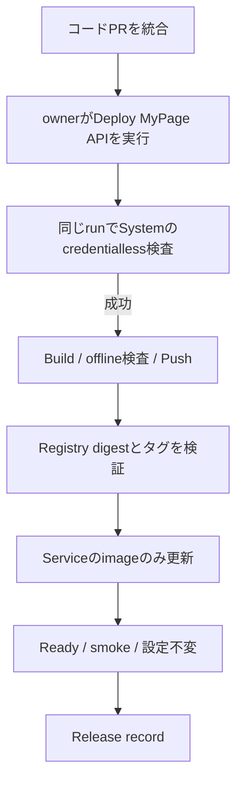

# MyPage DEV Backend のアプリケーション CI/CD

この文書は DEV 環境の Cloud Run API サービス（`test-youtube-study-space` / `asia-southeast2` / `mypage-api`）のビルド・配備手順と責任境界を説明します。

- Maintenance Job（`mypage-maintenance-operator`）は別の配備単位です。詳細は「[Maintenance Operator の配備](#maintenance-operatorの配備)」を参照してください。
- 責任の分担として、Terraform はサービス・IAM・Secret 参照・リソース設定を管理し、CI/CD は作成後のコンテナイメージだけを更新します。イメージをビルドするたびに PR で digest を書き換えたり、Terraform Plan/Apply でアプリをリリースしたりしません。

> [!NOTE]
> 本書は実装されている方針と手順を説明するものであり、実際のクラウド上で新 CI が成功したことや、Production・OAuth 実 E2E・Privacy/GA4・一般公開の承認を示すものではありません。実クラウドの成功可否は Actions の実行記録で確認してください。

---

## 通常の DEV アプリケーションリリース

PR や `push` を契機とした自動配備は行いません。以下の手順で手動実行します。

1. コード PR の統合: レビューと必須チェック（`CI Gate`）を通し、`integration/mypage-canon-20261006` へ統合します（PR の `CI` にはクラウド資格情報を渡しません）。
2. デプロイワークフローの起動: オーナーが統合ブランチ上で `Deploy MyPage API`（[`deploy-mypage-api.yml`](../../../.github/workflows/deploy-mypage-api.yml)）を `mode=build-and-deploy` で実行します。
   - まず同じ Run 内で、資格情報を使わない System 側の事前検査（Go test・lint・vuln・Firestore Emulator・両イメージのビルド）を実行します（Ruleset は統合後のツリー全体を再検査しないため、配備対象コミットで実行します）。
   - 検査失敗や、想定外の actor・ref・event・caller・再実行はクラウド認証の前に停止します。
3. イメージのビルドと検証: `mypage-foundation-authenticated.yml` の `image-build`（`image_component=api`）が `system/Dockerfile.mypage-api`（API サーバー専用）から `linux/amd64` イメージをビルドします。
   - オフライン・nonroot 検査のあと、Git SHA を不変タグとして Artifact Registry へ push します。
   - Registry のメタデータと Docker の `RepoDigests` を照合した正確な digest（`@sha256:...`）だけを後続のジョブへ渡します（タグでの配備は行いません）。
4. Cloud Run イメージの差し替え: Deploy ジョブが専用 Backend reusable workflow へ digest と source SHA を渡し、DEV 専用 WIF と短命トークンで `tag → digest` を再確認します。
   - 現在の Cloud Run Service の identity・イメージ・設定・Hosting 版・統合 HEAD・Service の v1 `resourceVersion` を確認したうえで、Service のコンテナイメージだけを更新します（すでに同じ digest なら書き込みせず、Maintenance Job には触れません）。
5. 配備後の疎通・不変確認: 新リビジョンが Ready でトラフィック 100% になり、イメージ以外の設定・IAM・Secret 参照が変わっていないことを確認します。
   - Hosting 経由の匿名 API が `403 APP_CHECK_REQUIRED`、Cloud Run 直 URL が Host 境界の `400 INVALID_REQUEST` をともに `no-store` で返し、`/` と `/mypage` を配信できることを検査します。
   - 成否にかかわらず、復旧用のリリース記録（`release record`）を保存します。
6. 完了確認: `mypage-backend-verified-record` で完了を確認します。**リリース中に Terraform は一切起動せず、State の refresh や Apply も行いません。** 対象 digest・リビジョン・source SHA・旧 digest・Hosting 版はその Run の記録を正とします。

---

## Terraform との責任境界

- 初回作成時と作成後の分担
  - Cloud Run Service の既存 bootstrap イメージは Terraform 入力として残りますが、通常リリースでは更新しません。
  - Maintenance Job を DEV で初めて作成するときだけは、Job が未存在であることを読み取り専用で確認したうえで、実ビルド済み・operator バイナリ含有を確認済みの固定 SHA タグを Artifact Registry から digest へ解決し、その Plan/Apply 専用の非公開入力として使います（GitHub Environment の設定 JSON へ maintenance 専用 digest/source SHA は保存しません）。
  - 作成後は Service・Job ともにコンテナのイメージだけを `lifecycle.ignore_changes` で CI/CD へ委譲します（`ignore_changes` をテンプレート全体には広げません）。CPU・メモリ・concurrency・環境変数・Secret バージョン・SA・ingress・traffic・IAM などは引き続き Terraform 管理です。
- 旧設定キーの扱い: 旧 Environment secret に残る `maintenance_operator_enabled` / `maintenance_operator_image_digest` / `maintenance_operator_image_source_sha` / `history_coverage_json` は読み込み時に除外し、その他の未知キーは拒否します。
- 次回インフラ Plan 時の互換性: 前回 State と現在 Cloud Run の間に複数リビジョンの正当なイメージのみの更新があっても、他の設定が不変なら通常の State refresh として受け入れます。一方で Registry 以外のイメージ、env・Secret・権限・scale・traffic 変更や予期しない update/replace/delete は引き続き停止します。
- 権限の相互分離: リリース用 actor に Terraform State / AWS backend の権限を付けず、Terraform の Plan/Apply actor にもアプリのイメージ更新権限を追加しません。
- 競合の抑止: DEV の通常インフラ操作と Backend リリースは同じ concurrency group で競合を防ぎます。Hosting リリースとの競合は各実行での Hosting 版・HEAD 照合と運用上の停止調整で対処します（クラウド間の完全な原子性は保証しません）。
- 旧設定ファイルの廃止: 2026-10 の旧方式のリリース設定ファイルは履歴として Git 履歴に残すのみで、現在の CI/CD や Terraform の入力としては使いません。

---

## 初回有効化条件

ソースレビューと静的 CI の成功だけでは、新しい配備経路の実接続や本番公開の完了とみなしません。初回有効化前に以下を確認・実施してください。

- foundation GCP WIF の更新: DEV の `mypage-foundation` pool / `github-actions` provider の condition を `python3 infra/mypage-platform/scripts/foundation_contract.py provider-condition` の出力で置き換えます（`workflow_ref` と完全一致の `sub` を組で更新し、`workflow_dispatch` のみ許可・旧 `ci.yml` の `push` を除外。image-build では AWS State Role を使いません）。
- Backend 専用 WIF の更新: DEV の `mypage-dev-backend` 用 WIF の condition を [backend_identity.py](../../../infra/mypage-platform/scripts/backend_identity.py) の `--update-condition` で置き換えます（`workflow_dispatch` のみ、caller `deploy-mypage-api.yml`、reusable `mypage-backend-authenticated.yml`、同一 workflow SHA、Environment `mypage-dev-backend` を要求し、`push` は不可）。Cloud Run `mypage-api` への限定 IAM は維持し、Production の IAM・WIF・Environment は変更しません。
- 資格情報の露出防止: GitHub Environment は統合ブランチに限定し、配備用資格情報を PR ワークフローに露出しません。
- 実測での有効化判断: 最初の `Deploy MyPage API` で「ビルド → digest 検証 → Cloud Run 更新 → 匿名 smoke → 配備記録」を実測してから運用を有効とします（condition 未更新なら認証で失敗するのが正しい挙動であり、再実行で迂回しません）。

---

## 手動配備・ロールバック

DEV 環境に限り、`Deploy MyPage API` を `mode=deploy-existing` で実行し、`image_digest` と `image_source_sha` を指定して既知のイメージを再配備できます（このモードではビルドを行いません）。

- 指定した不変タグと digest の完全一致、および `image_source_sha` が現在の統合 HEAD の祖先であることを確認します。
- ロールバックは既知の良好な digest / source SHA を指定する新しい配備として行います。事前にリビジョン・旧 digest・Hosting 互換性・Auth と同意バージョン・秘密参照・設定を確認してください。
- Service の更新は `resourceVersion` 付きの PUT を 1 回だけ実行し、自動再試行や自動ロールバックは行いません。応答が消失した場合は `publishStatus=unknown` として記録し、実 Cloud Run の状態を読み戻して復旧します。旧 digest / リビジョンの配備記録は 14 日間保持し、ユーザーデータや Secret は巻き戻しません。

---

## 専用 Backend identity の境界

[backend_identity.py](../../../infra/mypage-platform/scripts/backend_identity.py) で管理する DEV 専用の `mypage-backend-deploy` SA / WIF を使用します。

- 付与する最小権限
  - `mypage-api` Service の `run.services.get` / `run.services.update`
  - API ランタイム SA へのリソース単位の `roles/iam.serviceAccountUser`（`actAs`）
  - DEV Artifact Registry の reader、Hosting viewer、quota 用最小権限
  - （※過去に Terraform で付与していた `mypage-maintenance-operator` Job の `run.jobs.get` / `run.jobs.update` と maintenance runtime SA への `actAs` の 2 binding は、DEV での初回 Maintenance Operator 配備確認後、2026-11-01 の [run 41260474728](https://github.com/kani3camp/youtube-study-space/actions/runs/41260474728) で削除済みです。読み戻しで `mypageMaintenanceImageRelease` と `roles/iam.serviceAccountUser` のメンバーが `mypage-operator-deploy` のみになったことを確認しました。今後の MyPage Terraform 削除は [Plan 承認手順](../../development/ci-cd-workflows.md#32-terraform-plan--apply) を使います。）
- 権限の補足: `run.services.update` と `actAs` の組み合わせは IAM の仕様上イメージ以外のフィールドも更新し得るため、イメージ固定・コミット/digest 照合・v1 `resourceVersion`・前後全設定比較・CI 保護・手動運用を組み合わせて安全性を担保しています。Secret 本文・IAM setter・Cloud Run 作成/削除・Production 権限は付与しません。

---

## Maintenance Operatorの配備

Maintenance Job `mypage-maintenance-operator` のイメージは、API Service とは独立した配備単位として `Deploy Maintenance Operator`（[`deploy-mypage-maintenance.yml`](../../../.github/workflows/deploy-mypage-maintenance.yml)）だけで更新します（API リリースと同じ digest へは同期しません）。

> [!IMPORTANT]
> `core/mypage` の `MaintenanceControl` や Firestore スキーマを変更する PR では、前後互換を保つか、API と Operator の両方の配備が必要であることを PR 説明に明記してください。

### 配備手順

1. 統合ブランチ（`integration/mypage-canon-20261006`）上で `mode=build-and-deploy` を実行します。資格情報取得の前に System の事前検査（`ci-system.yml`）を通し、`system/Dockerfile.mypage-maintenance-operator`（operator バイナリ専用）をビルドします。オフライン・nonroot 検査後、`mypage/mypage-maintenance-operator:<source SHA>` として push し、Registry と `RepoDigests` を照合した digest を次ジョブへ渡します。
2. [operator_release.py](../../../infra/mypage-platform/scripts/operator_release.py) が、固定 actor・統合 ref・caller・初回実行・SHA 一致を認証前に検査したうえで、Environment `mypage-dev-operator` と `mypage-operator-deploy` SA/WIF で短命トークンを取得します。
   - `tag → digest` を再確認し、Job の identity・設定・現イメージを読み取ってコンテナイメージだけを 1 回の etag 付き PATCH で更新します。
   - Long-running Operation 完了・generation 前進・イメージ以外の設定不変を読み戻して初めて成功とします（`labels` / `annotations` は GET から保持し、`executionCount` などの出力専用状態は競合判定に使いません）。
3. **Job の実行は行いません**（実行するとメンテナンス状態が変わるため）。API Service・Hosting・Terraform・State・IAM にも触れません。
4. 成否にかかわらず `mypage-operator-release-record`（schema 1、旧イメージ・旧 generation を含む）を 14 日間保存し、受領ジョブが `mypage-operator-verified-record` を残します（自動再試行・自動ロールバックなし）。

- ロールバック: `mode=deploy-existing` で既知の良好な `mypage-maintenance-operator@sha256:...` とその `image_source_sha` を指定し、タグ/digest 一致と祖先コミット確認のうえ Job だけを更新します。
- 現在値における旧パッケージの許容: 新規環境では Job を runtime settings の API イメージ（`runtime_settings.image_digest`）で初回作成するため、最初の Operator 配備までの現在値として `mypage/mypage-api` パッケージも受け入れます（配備先は専用パッケージのみ。API イメージには Operator バイナリが無いため、Operator 配備まで Job は実行できません）。

### 初回有効化（リポジトリ外のオーナー作業）

- [operator_identity.py](../../../infra/mypage-platform/scripts/operator_identity.py) に `--apply` を付けて実行し、DEV 専用の `mypage-operator-deploy` SA、`mypage-operator` WIF pool/provider、Environment `mypage-dev-operator`、変数 `MYPAGE_OPERATOR_WIF_PROVIDER` を作成します（既定はプレビュー）。
- MyPage Terraform の Apply で、Job の `run.jobs.get` / `run.jobs.update` カスタムロールと maintenance Job ランタイム SA への `actAs` を `mypage-operator-deploy` へ付与します。
- イメージビルドは既存の `mypage-dev-apply`（`mypage-foundation` WIF）を使うため、provider の condition を `foundation_contract.py provider-condition` の出力（`deploy-mypage-maintenance.yml` の caller と `sub` を含む）で置き換えます。
