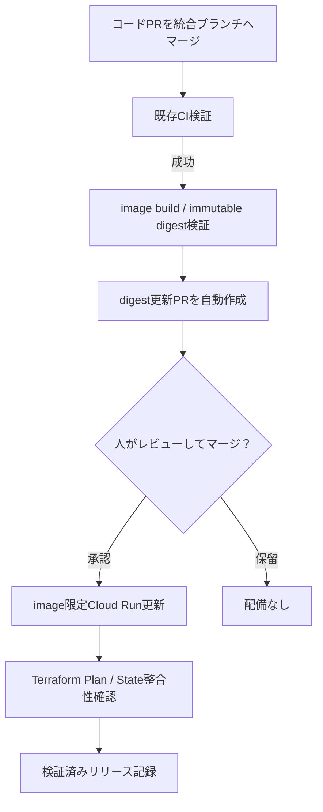

# DEV BackendをCIで配備する

対象は`test-youtube-study-space` / `asia-southeast2` / `mypage-api`のイメージ更新である。DEV専用WIFを使い、従来の所有者による操作をCIへ移す。本番、実OAuth・認証済みE2E、Privacy・GA4・公開条件の完了を意味しない。

## 推奨：ソースPRマージからのDEV自動CD

この経路はMyPage統合ブランチ `integration/mypage-canon-20261006` の**初回push**に限る。
`dev`/ `main` / Productionへの自動配備はしない。
PRマージを承認操作とし、ビルド・デプロイの実行権限をPR検証から切り離す。

1. `system/**` の変更を統合ブランチへPRでマージする。pushを受けた既存`CI`が、
   Repository/System/Frontend/Tools/Infra/Terraformの従来のcredentialless Gateをすべて通す。
2. 既存`mypage-image-build`のDEV専用、短命WIF認証で、**そのコミット**の
   `system/Dockerfile.mypage` をビルドする。
   オフライン検査後、immutableなコミットSHAタグでArtifact Registryへpushし、
   RegistryのversionとローカルRepoDigestsを相互照合する。検証済み`image_digest`だけをjob outputに渡す。
3. CIが `runtime-release.json` の**変更だけを含む別PR**を
   `automation/mypage-dev-image-<source-sha>` → 統合ブランチへ作る。
   新digest、ビルド元SHA、旧digestを明示し、HostとTerraformの他設定は変更しない。
   bot由来PRは標準の`pull_request`イベントを発火しないため、
   CIはそのPR headに対する検証専用 `workflow_dispatch(operation=validate)` を明示起動する。
4. **人がdigest変更PRとCIをレビューし、マージする。**
   これが対象イメージを配備してよいという承認であり、CIはPRを自動マージしない。
   `system/`とリリース宣言を同じpushで変更した場合は誤配備防止のため停止する。
5. リリース宣言のみのpushではイメージを再ビルドしない。既存の
   `mypage-backend-authenticated.yml` がビルド元`system` Git tree、Registry対応、
   旧配信digest、revision/UID/generation、Hosting版、最新統合HEADを確認した後、
   Cloud Runの**imageフィールドだけ**を更新する。新revisionがReady、
   最新への100% traffic、他設定不変、匿名疎通の期待どおりの拒否を検証する。
6. 成功時だけ既存`runtime-public-apply`へ進む。
   Terraformの独立PlanとApply間のHMAC一致、保存Plan、State/Resource Readback、
   事後検証を維持する。正常なno-opも成功扱いとするが、
   意図しない差分を勝手に無視・許可しない。
   `mypage-backend-verified-record`とCI Gateが成功してはじめて完了とする。

### 初回の認証・GitHub設定の切替

**このコードをマージするだけでは有効化は完了しない。**
既存のOIDC/WIFとTerraform State用AWS roleは`workflow_dispatch`に厳密固定されている。
切替時に管理者が、差分をレビューして以下を**先に**反映・readbackする。
事前のクラウド適用権限・現在の実IAM値を確認するまで、CIだけで適用しない。

- DEV FoundationのAWS State backend Plan/Apply roleには、既存の完全一致
  `workflow_dispatch` subjectを**維持したまま**、同じ固定repo/actor/ref/
  caller/reusable/Environmentの`push` subjectを個別に許可する。
  受入候補は`foundation_contract.trust_policy(account, kind)`の
  **DEV roleのみの2 statement**。Production roleは変更しない。
- DEV FoundationのGCP WIF providerも、同じ2種類の**完全一致**claimだけを許可する。
  Production/PR/`workflow_run`/tag/別actor/再実行を許可しない。
  DEV image-buildとState readbackは既存`mypage-dev-apply`、
  `mypage-dev-plan` Environmentに統合ブランチの権限制限を維持する。
- DEV Backend専用GCP WIF providerの条件は`backend_identity.condition()`の
  手動/初回push両方の完全一致式に変更する。既存の
  `mypage-dev-backend` Environmentのブランチ制限、専用SA、
  service単位の権限を保持する。新しい汎用admin権限は不要。
- リポジトリのGitHub Actionsで`GITHUB_TOKEN`のPR作成を許可する
  （`Allow GitHub Actions to create and approve pull requests`）。
  workflow内ではdigest PR作成jobだけに`contents:write`、
  `pull-requests:write`、`actions:write`を付与する。
  bot作成PRには通常のPRイベントが届かないため、検証は明示dispatchする。
  必須CIが完了しないPRはマージしない。

認証主体・既存のtrustを一括緩和しない。上記設定が未更新なら、
**push CDは失敗が正しい**。既存の手動`workflow_dispatch`経路は残す。
毎回の手動terraform操作をCIから要求しない代わりに、TerraformによるState整合を
デプロイ成功の必須条件として維持する。

### 停止条件・復旧

- 統合HEAD移動、未検証digest、前image不一致、Registry tag不一致、build元tree不一致、
  配備以外のdrift、認証失敗、CI失敗は停止する。
- GitHub`GITHUB_TOKEN`によるPR作成では別PRのCIを自動発火しないため、
  botが明示的にvalidation dispatchを試みる。作成後にdispatchが失敗した場合は
  PRの状態を確認し、**承認せず**credentialless CIを再実行する。
- 部分的にCloud Runが切り替わってState整合で失敗した場合、実環境は切替済みの
  可能性がある。自動再試行・自動rollbackを行わず、リリース記録と実際の
  image/revision/Hosting/Stateを読み戻してから復旧する。
- 一度配備したdigestを次の基準にする。複数のリリースPRを並行承認して
  旧基準を上書きしない。必要なら現在配信中digestを起点とする新しいPRを作る。

### 手動経路（障害対応・移行期間）

これまでの`CI`→`operation=mypage-image-build` /
`environment=development`によるBuild、
`runtime-release.json`をレビューして更新、
`operation=mypage-backend-release`によるDEV配備を維持する。
配備後のState readbackと失敗時の照合は自動経路と同一である。

## 初回接続

[初期設定スクリプト](../../../infra/mypage-platform/scripts/backend_identity.py)は、引数なしならプレビューだけを行い、`--apply`で以下を追加する。既存名があれば停止する。ソースレビューとCI検証後に接続し、実再読み取りと配備実行を記録する。途中失敗後は現在状態を確認し、無条件に再実行しない。

| 追加先 | 権限・設定 |
| --- | --- |
| DEV専用SA `mypage-backend-deploy` | keyなし。既存Terraform identity/State権限は変更しない |
| DEV `mypage-backend` WIF pool/provider | repo/owner/actor固定ID、初回workflow_dispatch、統合ref、caller `ci.yml`、本reusable、同一workflow SHA、専用Environmentと完全subject |
| `mypage-api` serviceだけ | custom role: `run.services.get` / `run.services.update` |
| `mypage-api` runtime SAだけ | `roles/iam.serviceAccountUser`（actAs） |
| DEV `mypage` registryだけ | `roles/artifactregistry.reader`。pushは既存image-build経路 |
| DEV project | `roles/firebasehosting.viewer`（Hosting版比較）、`roles/serviceusage.serviceUsageConsumer`（quota）。Hosting writeなし |
| GitHub `mypage-dev-backend` | integration branchだけ/tagなし。非秘密Variable `MYPAGE_BACKEND_WIF_PROVIDER` |

**IAMの能力**：`run.services.update` はimage以外の設定も変更でき、runtime SAのactAsと組み合わさるとそのSAの権限で任意コードを実行できる。IAMでimage fieldだけに限定したとは呼ばない。固定対象/source/digest/WIF admission/保持比較/CI保護で運用境界を設ける。Secret payload read、IAM setter、Cloud Run create/delete、Production権限をCIへ直接付与しない。公式根拠：[配備権限](https://docs.cloud.google.com/run/docs/reference/iam/roles)、[v1 replaceService](https://docs.cloud.google.com/run/docs/reference/rest/v1/namespaces.services/replaceService)。

## 失敗・復旧

Hostingとバックエンドはリリースの同時実行制御を共有する。実行中は所有者や別経路からの更新を避ける。Cloud RunのresourceVersionはCloud Run内の競合を拒否するが、Hostingやブランチを含むアトミック切替は保証しない。直前・配備後の比較に失敗したら停止する。

変更前に14日保存の`mypage-backend-release-record`を作り、前リビジョン・ダイジェスト、今回のダイジェスト・ビルド元SHA、Hostingバージョン、実行情報を記録する。応答消失は`publishStatus=unknown`とする。Secret値・全環境変数・API応答全文・State・Planは成果物に出さない。State確認成功時だけ、別の検証済み記録を`stateReadback=passed`にする。

自動再試行・ロールバックは行わない。失敗後は現在のリビジョン・ダイジェスト・Hostingバージョン・Stateを読み取り専用で照合する。今回のダイジェストが配信中なら、バックエンド配備は再実行しない。元の実行も再実行せず、疎通確認や競合の原因を直し、必要な既存`runtime-public-plan` / `runtime-public-apply`を新しい実行で行う。State検査が許可しない差は無視しない。ロールバック時はフロントエンドの互換性を確認し、旧イメージを明示した別リリース宣言をレビューして同じCIで配備する。ユーザーデータやSecretは巻き戻さない。
