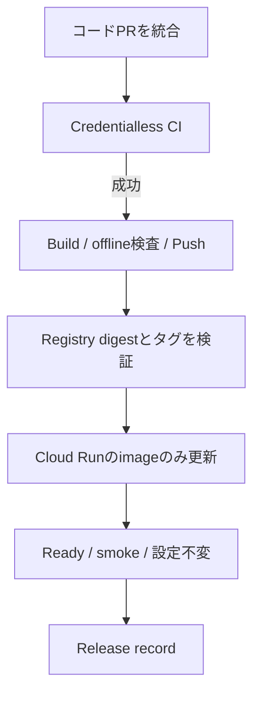

# MyPage DEV BackendのアプリケーションCI/CD

対象は `test-youtube-study-space` / `asia-southeast2` / Cloud Run `mypage-api`。
**Terraformはサービス・IAM・Secret参照・リソース設定を管理し、CI/CDは作成後のコンテナイメージを管理する。**
アプリケーションをビルドするたびにPRでdigestを更新したり、Terraform Plan/Applyでリリースしたりしない。
本ページは採用方針とソース手順を説明する。新CIが実クラウドで成功したかは別途Actions/配備記録で確認する。
Production・OAuthの実E2E・Privacy/GA4・一般公開の承認は対象外。

## 通常のDEVアプリケーションリリース

1. コードPRをレビューし、`integration/mypage-canon-20261006`へ統合する。
   `system/**`のpushだけがDEV用の自動リリース候補になる。PRの`CI`は資格情報を持たない。
2. 当該統合commitの`CI`がRepository、System、Frontend、Tools、Infra、GCP Terraformのcredentialless検査を完了する。
   検査失敗・予定外のactor/ref/event/再実行はクラウド認証前に停止する。
3. `mypage-image-build` が固定の`system/Dockerfile.mypage`からlinux/amd64のイメージをビルドし、
   offline・nonroot検査後、Git SHAをimmutabilityのあるArtifact Registry tagにしてpushする。
   Registry metadataとDocker RepoDigestsを照合した **正確なdigest** を同じActions run内のjob outputに渡す。
   タグを本番のデプロイ参照に用いず、`@sha256:...`だけを使う。
4. `mypage-auto-deploy`はそのrunのdigestとsource SHAを専用backend reusable workflowへ渡す。
   DEV専用WIF/短命tokenでtag→digestを再確認する。現Cloud Runのidentity・Ready・image・設定、
   Hosting版、統合HEAD、v1 resourceVersionを確認し、**現在のServiceをコピーしてimageだけを置き換える**。
   既に同じdigestを配信中なら、書き込みはせず疎通だけ検査する。
5. 新リビジョンがReady、最新へ100%トラフィック、非imageのCloud Run設定・IAM/Secret参照が不変であることを再確認する。
   Hostingの匿名APIが`APP_CHECK_REQUIRED`の403、Cloud Run直URLがHost境界の`INVALID_REQUEST`の400を
   それぞれ`no-store`で返し、`/`と`/mypage`を配信できることを検査する。
   成功と失敗の両方で復旧用のrelease recordを保存する。
6. 配備完了は`mypage-backend-verified-record`と`CI Gate`で確認する。
   **Terraformはリリース中に一切起動しない。Stateのrefresh/Applyも行わない。**
   対象のdigestとrevision、source SHA、旧digest、Hosting版はそのrunの記録を正とする。

## Terraformとの責任境界

- `infra/mypage-platform/modules/runtime/main.tf` はCloud Runの初回作成時にimmutableなbootstrap imageを指定する。
  作成後は`lifecycle.ignore_changes = [template[0].containers[0].image]`で **imageだけ** をCI/CDへ委譲する。
- CPU・メモリ・concurrency・環境変数・Secret version・サービスアカウント・ingress・traffic・IAM等は
  Terraform/既存専用運用が管理する。`ignore_changes`をtemplate全体に広げない。
- Terraformの`gcp-plan`/`gcp-apply`はインフラ構成を変更するときだけ使う。
  次回のインフラPlanで、前回Stateと現在Cloud Runの間に複数リビジョンの**正当なimage-only更新**があっても
  設定が不変ならStateの通常refreshとして観測できるよう検査する。
  Registry以外のimage、env/Secret/権限/scale/traffic変更、計画的な予期せぬupdate/replace/deleteは引き続き停止する。
- CI/CDのrelease actorにTerraform State/AWS backendアクセス権を付けず、
  TerraformのPlan/Apply actorにアプリのイメージ更新権限を追加しない。
- DEVの通常インフラ操作とbackend releaseは同じconcurrency groupで競合を抑止する。
  Hosting releaseとの競合は各実行のHosting版・head照合と実行者による運用停止も必要であり、
  クラウド間の完全な原子性は保証しない。
- 既存の`runtime-release.json`は2026-10の旧方式の履歴情報であり、
  **現在のCI/CD・Terraform実行入力として参照しない。** 新リリースごとに編集・コミットしない。
  後日archive/削除する場合は参照元を整理し、追跡用の旧commitを保持する。

## 初回有効化条件

このPRのソースレビューと静的CIの成功だけでは、新しいCDの実接続や本番公開を宣言しない。

- DEVの`mypage-dev-apply`に使う **GCP WIF** の固定 `push` claimsを、既存の本人/固定branch/caller/
  reusable/同一SHA/Environmentの厳格制約のままレビュー・適用する。
  image-buildではAWS State Roleを使わないため、**AWS Terraform State Roleにpush許可を追加しない。**
- DEVの`mypage-dev-backend`専用GCP WIFも、同一repo・同一本人・統合branch・正確なcaller/reusableと
  一回目のpushだけを追加許可する。Cloud Run `mypage-api`への限定IAMは維持する。
  Production IAM/WIF/Environmentを変えない。
- GitHub Environmentは統合ブランチに限定し、Cloud Run配備用資格情報をPRのWorkflowに露出しない。
  `GITHUB_TOKEN`のPR作成権限は不要。
- 現行DEVのCloud RunとTerraform Stateのservice・設定・image・revision、既存registry image、
  Secret/Hosting/同意版・固定Originとデプロイ権限をread-onlyで確認する。
  `ignore_changes`導入後の実native Planで、配信中imageの巻き戻しや予期しない操作が無いことを確認する。
- 最初の統合ブランチpushによるBuild→digest→Cloud Run更新→匿名smoke→配備記録を実測してから運用を有効とする。
  認証やIAMを未設定ならpush CDは失敗で正しい。再実行でガードを迂回しない。

## 手動配備・ロールバック

DEVのみ、CIの`workflow_dispatch`で
`operation=mypage-backend-release`, `environment=development` を選ぶ。
`image_digest`と`image_source_sha`の両方を指定すれば、そのimmutable tagとdigestの完全一致を照合し、
source SHAが現在の統合HEADの祖先であることを確認する。
両方空なら現在の統合SHAのタグからdigestをread-onlyで解決する。
`mypage-image-build`を単独で行う場合も、ビルド/Pushによって自動的にCloud Runを変更しない。

ロールバックは既知の良好なdigest/source SHAを指定する**新しい配備**で行う。
対象のrevision、旧digest、Hosting互換性、Auth/同意版・秘密参照・設定を確認してから操作する。
Cloud Run imageの更新は1回のresourceVersion付きPUTのみで、自動再試行・自動rollbackはしない。
応答消失は`publishStatus=unknown`、配備後の疎通失敗も実Cloud Runのrevisionを確認して復旧する。
旧digestと旧revisionの実配備記録は14日保存する。ユーザーデータやSecretを巻き戻さない。

## 専用Backend identityの境界

[初回設定スクリプト](../../../infra/mypage-platform/scripts/backend_identity.py)の既存DEV専用
`mypage-backend-deploy` SA/WIFを使用する。
対象は`mypage-api` serviceの`run.services.get`/`run.services.update`、
同サービスruntime SAへの`roles/iam.serviceAccountUser`（actAs）、
DEV Artifact Registryのreader、Hosting viewerとquotaの必要最小権限。
GitHub Environment `mypage-dev-backend` とcallerの完全一致を維持する。

`run.services.update`はIAM上imageフィールド以外も編集可能であり、
`actAs`と組み合わさると実行権限を持つコードも配備できる。
**IAMでimage-onlyに限定できるわけではない。**
ソースの固定対象/commit/digest照合、v1 resourceVersion、前後の全設定比較、CI保護、
手動承認運用でこの広い能力を扱う。
Secret本文・IAM setter・Cloud Run create/delete・Production権限は付与しない。
