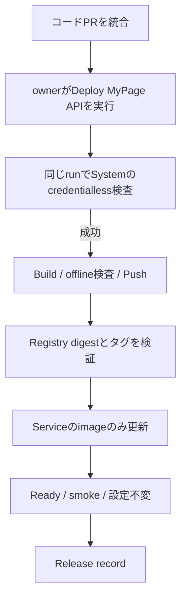

# MyPage DEV BackendのアプリケーションCI/CD

対象は `test-youtube-study-space` / `asia-southeast2` / Cloud Run `mypage-api`。
maintenance Job `mypage-maintenance-operator` は別の配備単位であり、[Maintenance Operatorの配備](#maintenance-operatorの配備)で扱う。
**Terraformはサービス・IAM・Secret参照・リソース設定を管理し、CI/CDは作成後のコンテナイメージを管理する。**
アプリケーションをビルドするたびにPRでdigestを更新したり、Terraform Plan/Applyでリリースしたりしない。
本ページは採用方針とソース手順を説明する。新CIが実クラウドで成功したかは別途Actions/配備記録で確認する。
Production・OAuthの実E2E・Privacy/GA4・一般公開の承認は対象外。

## 通常のDEVアプリケーションリリース

自動配備は行わない。PR・pushを契機に実環境へ書き込むworkflowは無い。

1. コードPRをレビューし、`integration/mypage-canon-20261006`へ統合する（rulesetがPRと`CI Gate`を要求する）。
   PRの`CI`は資格情報を持たない。
2. ownerが`Deploy MyPage API`（[`deploy-mypage-api.yml`](../../../.github/workflows/deploy-mypage-api.yml)）を
   統合ブランチで`mode=build-and-deploy`として実行する。同じrun内で、まずSystemのcredentialless検査
   （Go test・lint・vuln・Firestore Emulator・両image build）を行う。rulesetは統合後のtreeそのものを検査しないため、配備対象のcommitで再実行する。
   検査失敗・予定外のactor/ref/event/caller/再実行はクラウド認証前に停止する。
3. `mypage-foundation-authenticated.yml`の`image-build`（`image_component=api`）が固定の`system/Dockerfile.mypage-api`（API serverだけを含む）からlinux/amd64のイメージをビルドし、
   offline・nonroot検査後、Git SHAをimmutabilityのあるArtifact Registry tagにしてpushする。
   Registry metadataとDocker RepoDigestsを照合した **正確なdigest** を同じActions run内のjob outputに渡す。
   タグを本番のデプロイ参照に用いず、`@sha256:...`だけを使う。
4. deploy jobはそのrunのdigestとsource SHAを専用backend reusable workflowへ渡す。
   DEV専用WIF/短命tokenでtag→digestを再確認する。現Cloud Run Serviceのidentity・image・設定、
   Hosting版、統合HEAD、Serviceのv1 resourceVersionを確認し、**Serviceのimageだけを置き換える**。
   maintenance Jobは読み取りも更新もしない。既に同じdigestなら書き込みは行わない。
5. Serviceの新リビジョンがReady、最新へ100%トラフィックで、非image設定・IAM/Secret参照が不変であることを再確認する。
   Hostingの匿名APIが`APP_CHECK_REQUIRED`の403、Cloud Run直URLがHost境界の`INVALID_REQUEST`の400を
   それぞれ`no-store`で返し、`/`と`/mypage`を配信できることを検査する。
   成功と失敗の両方で復旧用のrelease recordを保存する。
6. 配備完了は`mypage-backend-verified-record`で確認する。
   **Terraformはリリース中に一切起動しない。Stateのrefresh/Applyも行わない。**
   対象のdigestとrevision、source SHA、旧digest、Hosting版はそのrunの記録を正とする。

## Terraformとの責任境界

- Cloud Run Serviceの既存bootstrap imageはTerraform入力として残るが、通常releaseでは更新しない。maintenance JobをDEVで初めて作るときだけ、Job不存在をread-only確認したうえで、実ビルド済み・operator binary含有をsourceで確認した固定SHA tagをArtifact Registryからdigestへ解決し、**そのPlan/Applyだけのprivate入力**として使う。GitHub Environmentの設定JSONへmaintenance専用digest/source SHAを保存しない。
- 作成後はService/Jobともcontainer **imageだけ** を`lifecycle.ignore_changes`でCI/CDへ委譲する（ServiceはこのBackend release、JobはMaintenance Operatorの配備）。Jobのcommand/env/resources/IAM/runtime SA等はTerraform管理のまま。
- 旧Environment secretに `maintenance_operator_enabled` / `maintenance_operator_image_digest` / `maintenance_operator_image_source_sha` が残っていても、移行互換としてその3キーだけを読み捨てる。private tfvarsやPlanには伝播せず、他の未知キーは引き続き拒否する。運用上は確認後に旧3キーを削除する。
- CPU・メモリ・concurrency・環境変数・Secret version・サービスアカウント・ingress・traffic・IAM等は
  Terraform/既存専用運用が管理する。`ignore_changes`をtemplate全体に広げない。
- TerraformのPlan/Applyはインフラ構成を変更するときだけ使う。
  次回のインフラPlanで、前回Stateと現在Cloud Runの間に複数リビジョンの**正当なimage-only更新**があっても
  設定が不変ならStateの通常refreshとして観測できるよう検査する。
  Registry以外のimage、env/Secret/権限/scale/traffic変更、計画的な予期せぬupdate/replace/deleteは引き続き停止する。
- CI/CDのrelease actorにTerraform State/AWS backendアクセス権を付けず、
  TerraformのPlan/Apply actorにアプリのイメージ更新権限を追加しない。
- DEVの通常インフラ操作とbackend releaseは同じconcurrency groupで競合を抑止する。
  Hosting releaseとの競合は各実行のHosting版・head照合と実行者による運用停止も必要であり、
  クラウド間の完全な原子性は保証しない。
- 既存の`runtime-release.json`は2026-10の旧方式の履歴情報であり、
  **現在のCI/CD・Terraform実行入力として参照しない。** 新リリースごとに編集・コミットしない。
  後日archive/削除する場合は参照元を整理し、追跡用の旧commitを保持する。

## 初回有効化条件

このPRのソースレビューと静的CIの成功だけでは、新しい配備経路の実接続や本番公開を宣言しない。

- DEVの **foundation GCP WIF**（`mypage-foundation` pool / `github-actions` provider）のconditionを、
  `python3 infra/mypage-platform/scripts/foundation_contract.py provider-condition` の出力で置き換える。
  providerは`workflow_ref`と完全一致の`sub`の両方を検査するため、caller（`deploy-mypage-api.yml` など）と`sub`を組で更新する。
  出力は`workflow_dispatch`だけを許可し、旧`ci.yml`の`push` claimを含まない。image-buildではAWS State Roleを使わない。
- DEVの`mypage-dev-backend`専用GCP WIFのconditionを、[初回設定スクリプト](../../../infra/mypage-platform/scripts/backend_identity.py)の
  `--update-condition`で置き換える。新しいconditionは`workflow_dispatch`だけ、caller `deploy-mypage-api.yml`、
  reusable `mypage-backend-authenticated.yml`、同一workflow SHA、Environment `mypage-dev-backend`を要求し、`push`を許可しない。
  Cloud Run `mypage-api`への限定IAMは維持する。Production IAM/WIF/Environmentを変えない。
- GitHub Environmentは統合ブランチに限定し、Cloud Run配備用資格情報をPRのWorkflowに露出しない。
- 最初の`Deploy MyPage API`によるBuild→digest→Cloud Run更新→匿名smoke→配備記録を実測してから運用を有効とする。
  conditionを未更新なら認証で失敗するのが正しい。再実行でガードを迂回しない。

## 手動配備・ロールバック

DEVのみ、`Deploy MyPage API`を`mode=deploy-existing`で実行し、`image_digest`と`image_source_sha`の両方を指定する。
そのimmutable tagとdigestの完全一致を照合し、source SHAが現在の統合HEADの祖先であることを確認する。
このmodeではimageをbuildしない。

ロールバックは既知の良好なdigest/source SHAを指定する**新しい配備**で行う。
対象のrevision、旧digest、Hosting互換性、Auth/同意版・秘密参照・設定を確認してから操作する。
Serviceは1回のresourceVersion付きPUTで更新し、自動再試行・自動rollbackはしない。
応答消失は`publishStatus=unknown`として残し、配備後の疎通失敗も実Cloud RunのServiceをreadbackして復旧する。
旧digestと旧revisionの実配備記録は14日保存する。ユーザーデータやSecretを巻き戻さない。

## 専用Backend identityの境界

[初回設定スクリプト](../../../infra/mypage-platform/scripts/backend_identity.py)の既存DEV専用
`mypage-backend-deploy` SA/WIFを使用する。
対象は`mypage-api` serviceの`run.services.get`/`run.services.update`とAPI runtime SAへのresource-level `roles/iam.serviceAccountUser`（actAs）。
Terraformが過去に付与した固定`mypage-maintenance-operator` Jobの`run.jobs.get`/`run.jobs.update`とmaintenance Job runtime SAへのactAsは、このreleaseではもう使わない。
**旧bindingは、初回のMaintenance Operator配備でJobが専用packageへ移ったことを確認してから、削除専用のTerraform遷移で外す**（現在のruntime契約はcreate/no-opだけを許可するため、同じPRでは削除しない）。
DEV Artifact Registryのreader、Hosting viewerとquotaの必要最小権限。
GitHub Environment `mypage-dev-backend` とcallerの完全一致を維持する。

`run.services.update`はIAM上imageフィールド以外も編集可能であり、
`actAs`と組み合わさると実行権限を持つコードも配備できる。
**IAMでimage-onlyに限定できるわけではない。**
ソースの固定対象/commit/digest照合、v1 resourceVersion、前後の全設定比較、CI保護、
手動承認運用でこの広い能力を扱う。
Secret本文・IAM setter・Cloud Run create/delete・Production権限は付与しない。

## Maintenance Operatorの配備

maintenance Job `mypage-maintenance-operator` のimageは、API Serviceと独立した配備単位として
`Deploy Maintenance Operator`（[`deploy-mypage-maintenance.yml`](../../../.github/workflows/deploy-mypage-maintenance.yml)）だけが更新する。
API releaseとは同じdigestへ同期しない。`core/mypage` のMaintenanceControl / Firestore schemaを変えるPRは、
前方・後方互換を保つか、APIとOperatorの両方の配備が必要であることをPR説明に明記する。

1. `integration/mypage-canon-20261006`を選び、`mode=build-and-deploy`で実行する。
   同じrun内で、資格情報を取得する前にSystemのcredentialless検査（`ci-system.yml`）を通す。
   `system/Dockerfile.mypage-maintenance-operator`（operator binaryだけを含む）をビルドし、offline・nonroot検査後に
   `mypage/mypage-maintenance-operator:<source SHA>`のimmutable tagでpushし、Registry metadataとRepoDigestsを照合したdigestを次のjobへ渡す。
2. [配備スクリプト](../../../infra/mypage-platform/scripts/operator_release.py)は、固定actor・統合ref・caller・初回実行・SHA一致を
   クラウド認証の前に検査する。Environment `mypage-dev-operator` と専用 `mypage-operator-deploy` SA/WIFで短命tokenを取得し、
   tag→digestを再確認する。Jobのidentity・設定・現imageを読み、**Jobのcontainer imageだけ**を1回のetag付きPATCHで更新する。
   Long-running Operation完了とgeneration前進、image以外の設定不変をreadbackしてから成功扱いにする。
   labels/annotations等のユーザー設定をGETから保持し、executionCount/latestCreatedExecution等の出力専用状態は競合判定に使わない。
3. **Jobは実行しない**（実行はmaintenance modeを変更するため）。API Service・Hosting・Terraform・State・IAMには触れない。
4. 成功・失敗のどちらでも`mypage-operator-release-record`（schema 1、旧image・旧generationを含む）を14日保存し、
   受領jobが`mypage-operator-verified-record`を残す。自動再試行・自動rollbackはしない。

ロールバックは`mode=deploy-existing`で、既知の良好な`mypage-maintenance-operator@sha256:...`のdigestとそのsource SHAを指定する。
tagとdigestの一致、source SHAが現在の統合HEADの祖先であることを確認してからJobだけを更新する。

移行中のJobは、旧API同梱image（`mypage/mypage-api`）を指していてもよい。Terraform契約と配備スクリプトは両packageを現在値として受け入れ、
配備先は専用packageに限る。初回配備で切替を確認した後、旧packageの許容と旧Backend deployerのJob権限を外す。

初回有効化（owner作業、リポジトリ外）:

- [初回設定スクリプト](../../../infra/mypage-platform/scripts/operator_identity.py)の`--apply`で、DEV専用の`mypage-operator-deploy` SA、
  `mypage-operator` WIF pool/provider、Environment `mypage-dev-operator`と変数`MYPAGE_OPERATOR_WIF_PROVIDER`を作る（既定はプレビュー）。
  providerは固定repository・owner・actor、`workflow_dispatch`、初回実行、統合ref、caller `deploy-mypage-maintenance.yml`、
  reusable `mypage-operator-authenticated.yml`、同一workflow SHA、Environmentをすべて検査する。
- MyPage TerraformのApplyで、Job `run.jobs.get`/`run.jobs.update` custom roleのbindingと、maintenance Job runtime SAへのactAsを
  `mypage-operator-deploy`へ付与する。
- image buildは既存の`mypage-dev-apply`（`mypage-foundation` WIF）を使う。このproviderのconditionを、上記の
  `foundation_contract.py provider-condition` の出力で置き換える（`deploy-mypage-maintenance.yml`のcallerと`sub`を含む）。
